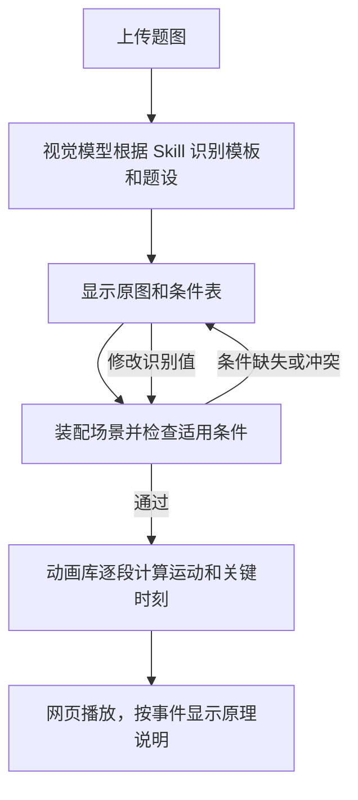

# 物理题动画生成器 · 参赛最终方案

2026 Qoder 高校创造力大赛 StudyHack 学习科研赛道。按 **11 月 17 日开工，11 月 20 日完成公网主链验收，11 月 23 日提交** 排期。

## 1. 一周交付什么

学生上传一张高中力学题的图片，网站把题目的运动过程生成可播放的动画。学生可以对照原图核对和修改识别条件，并暂停在发生转向、接触弹簧、压缩最短等关键时刻。每个关键点配一句与画面同步的原理说明。

| 优先级 | 交付内容 |
|---|---|
| **P0 · 提交版** | JPG/PNG 单题图片上传，AI 识别题设，条件核对与编辑，斜面滑动 → 转向 → 光滑水平面 → 压缩弹簧并反弹。含播放、暂停、重播、前进到下一关键点、内置示例和 Qoder Sites 公网访问。 |
| **P1 · 公网验收通过后** | 用已有滑动模块接平抛，演示「提前停在桌面」和「离桌后落地」两条路径。 |
| **后续迭代** | 碰撞、滑块与木板等运动模块，以及 HEIC、滑块实时探索、时间轴吸附和分享链接。 |

首版的覆盖范围是**已登记的综合题组合**。动画库按运动阶段组织，每段统一接收位置、速度和题设参数，返回一段可取样的运动及结束状态。将来可以把同一段运动接到不同题目里。优先用第二条已跑通的组合证明复用。

## 2. 工作流程



1. **AI 读图。** 把题图和模板说明一起交给支持图片输入的模型。一次请求返回模板名、题目给出的数值及模型能确认的前提。图片模糊或尺寸未标注时保留缺项。视觉模型可以选用支持图像输入的 API。 [百炼视觉理解文档](https://help.aliyun.com/zh/model-studio/vision)
2. **程序装配。** `assembleScene(reading)` 把读出的题设转成绘制位置和运动阶段。已登记模板决定阶段顺序。斜面终点的位置和速度由计算得出，接下来的水平段继承转向后的速度。
3. **库计算并核对。** `buildMotion(scene)` 求每段时长、位置、速度和关键事件。核对阶段衔接、位置连续和受力方向，再用结果生成字幕。比如弹簧压缩最短时，滑块的速度为零，弹力与加速度大小达到最大。
4. **播放器呈现。** 画面和字幕使用同一个时间。学生改条件后，浏览器重新装配场景并计算运动，图形和时间轴一起更新。原图留在页面供核对。

## 3. 主演示题与物理原理

> 质量 1 kg 的滑块从一条长 4 m、倾角 37° 的粗糙斜面顶端由静止释放，释放后开始沿斜面下滑。斜面动摩擦因数为 0.5。斜面底端经过一段长度和高度变化均可忽略的光滑圆弧接到光滑水平面。轻弹簧处于原长时，左侧接触端在斜面底端右方 1 m，右端固定，劲度系数为 400 N/m。滑块与弹簧不连接。取 $g=10\ \mathrm{m/s^2}$，展示滑块从释放到压缩弹簧、反弹并脱离的全过程。

取斜面底端为坐标原点，水平向右、竖直向上。**数值和绘图统一用题面实际的 37°**，坡顶约为 $(-3.1945,\,2.4073)$ m。

- **沿斜面滑动。** 沿下坡方向加速度 $a=g(\sin\theta-\mu_k\cos\theta)$。起动由题设给出。动摩擦因数用于计算已经发生的滑动。 [OpenStax 摩擦](https://openstax.org/books/university-physics-volume-1/pages/6-2-friction)
- **转向与水平运动。** 在题设的光滑、近似无高度差过渡中，保留速率，把方向转为水平。播放器将这段极短过渡表示为一个瞬时事件。转向后水平匀速前进 1 m。 [OpenStax 机械能守恒](https://openstax.org/books/university-physics-volume-1/pages/8-3-conservation-of-energy)
- **接触弹簧。** 在光滑水平面上，弹簧接触后的角频率为 $\omega=\sqrt{k/m}$。以接触瞬间为计时起点，压缩量为 $x=\frac{v}{\omega}\sin(\omega t)$。四分之一周期达到最大压缩，半个周期恢复原长并脱离，脱离速度向左。 [OpenStax 简谐运动](https://openstax.org/books/university-physics-volume-1/pages/15-1-simple-harmonic-motion)

| 全程时刻 | 事件 | 验收数值 |
|---|---|---|
| 0 s | 释放 | 斜面加速度约 2.0250 m/s² |
| 1.9876 s | 到达坡底、转向水平 | 速率约 4.0249 m/s，位置连续 |
| 2.2361 s | 接触弹簧 | 滑块已水平前进 1.00 m |
| 2.3146 s | 压缩最短 | 压缩量约 0.2012 m，速度为 0，弹力约 80.50 N，向左 |
| 2.3932 s | 恢复原长并脱离 | 水平速度约 −4.0249 m/s |

对外演示时可以让评委把劲度系数改成 100 N/m。最大压缩量变为约 0.4025 m，接触弹簧的时刻仍约为 2.2361 s。

## 4. 开工前确认三份契约

### 4.1 AI 给后端的识别数据

三人共用下面这份 `reading`。模型输出 JSON。数值统一成米、千克、秒及其导出单位，倾角用度。读不到的必填值用 `null`，前提事实用 `true`、`false` 或 `null`。后端校验字段和已登记模板，库检查场景的物理适用性。数值统一单位后仍要在页面上和原图核对。

```json
{
  "templateId": "incline_spring",
  "conditions": {
    "gravityMps2": 10,
    "inclineAngleDeg": 37,
    "inclineLengthM": 4,
    "kineticFrictionCoefficient": 0.5,
    "initialSpeedMps": 0,
    "blockMassKg": 1,
    "springGapM": 1,
    "springConstantNpm": 400
  },
  "facts": {
    "slidesAfterRelease": true,
    "losslessTurn": true,
    "horizontalIsFrictionless": true,
    "springIsUnattached": true
  }
}
```

P0 接受由静止开始下滑的题，`initialSpeedMps` 为 0，倾角大于 0° 且小于 90°，动摩擦因数可为 0，质量、长度、间距、劲度系数和重力加速度均为有限正数。必要事实应当明确为真。无法确认时提示核对，题设明确不满足时提示超范围。静止释放且计算出的沿坡加速度小于或等于 0 时，提示题设与所选模型的前提冲突。

**Skill 的交付**是一份网站后端会发给视觉模型的说明，包含可用模板、物理前提、字段、单位、缺项规则，以及一组成功和超范围样例。几何坐标、阶段接续和关键时刻由代码生成。

### 4.2 上传与改值

`POST /api/animation/plan` 接收 `multipart/form-data`，图片字段名 `image`。成功和缺项的回包都保留可编辑的 `reading`。如果图片模糊到无法识别模板，缺项回包可用 `reading: null`，页面提示重拍。

| 回包 | 页面行为 |
|---|---|
| 200，`{ "status": "ok", "reading": { ... } }` | 显示识别条件，调用本地装配和计算。 |
| 200，`{ "status": "needs_input", "reading": { ... }, "missingKeys": ["springGapM"], "message": "请确认弹簧接触端与斜面底端的距离" }` | 显示已经识别的条件，用户补值后可直接重算。 |
| 200，`{ "status": "unsupported", "message": "当前版本支持斜面接光滑水平面与弹簧的运动" }` | 提示当前题型范围，提供内置示例入口。 |
| 400、502 或 504，`{ "message": "..." }` | 对应图片无效、识别服务异常或超时。保留原图并提供重试。 |

浏览器中的「应用条件」按钮走同一条路径。将编辑后的 `reading` 交给 `assembleScene`，再把新场景交给 `buildMotion`。倾角、斜长和弹簧间距变更会一起更新世界坐标和运动。失败时指出对应字段，原图与输入值保留。

### 4.3 动画库给播放器的产物

`assembleScene(reading)` 成功时返回场景或返回字段错误。`buildMotion(scene)` 成功时返回下表中的本地对象，失败时返回可展示的 `code` 和 `message`。

| 字段或方法 | 约定 |
|---|---|
| `geometry` | 米制斜面端点、水平面位置、弹簧原长时的接触点与绘制所需的固定端。题目未给弹簧原长时，弹簧长度按示意画，压缩位移按计算值。 |
| `durationSeconds`、`segments` | 总物理时长，以及斜面滑动、水平匀速、弹簧接触三段的起止时间。 |
| `events` | 全程事件时间、名称和字幕。转向事件可带转向前、后的速度向量。 |
| `sampleAt(timeSeconds)` | 返回同一坐标系下滑块的位置、速度和弹簧压缩量。按事件时间取样时，采用事件后的状态。 |

转向和最大压缩都可以成为「下一关键点」的停靠位置。转向作为瞬时事件，最大压缩是弹簧接触段内的事件。播放器控制时间，绘图组件将物理坐标换成屏幕坐标。

## 5. 分工与 Qoder 协作

| 成员 | 开发责任 | 联调产物 |
|---|---|---|
| **A · 前端、播放器和集成** | 上传与预览、条件表、编辑反馈、世界坐标绘制、关键点和播放、内置示例。负责合并、联调和演示。 | 拿固定 `reading` 就能跑页面，换成真实接口后走同一条管线。 |
| **B · 动画库** | 斜面与水平滑动、无损转向、弹簧接触、场景装配、坐标和关键事件。维护共享字段和物理验收值。 | 用目标题输出可播放运动，改参数能稳定重算。 |
| **C · AI 接口、Skill 和部署** | 读图说明、模型接入、接口回包、密钥配置、Qoder Sites 部署与真实照片验收。 | 一张真实照片经公网接口返回完整或可补齐的 `reading`。 |

开工只需把本方案中的样例拆成一份共享 `reading`、一张标准题图和几条预期值。三人在同一仓库并行，各自把任务交给 Qoder，附上**可改范围、共享契约、验收动作**。A 可以先接固定结果，B 可以用同一数据写计算，C 可以独立试读图。接口或字段有改动时，先同步更新共享样例再合并。

实现建议沿用 Qoder 生成的前端工程，页面与纯计算库用 TypeScript 共用数据类型，绘制用 Canvas 2D，字幕和控件用网页元素。A 维护页面和播放器，B 维护纯计算与共享字段，C 维护图片接口和部署配置。

## 6. 七天执行安排

| 日期 | A · 前端和联调 | B · 动画库 | C · AI 和部署 | 日终检查 |
|---|---|---|---|---|
| **11/17** | 起上传页、结果页和播放器壳 | 定字段，建立标准物理算例 | 验证 Qoder Sites 上的页面能把真实图片交给服务端视觉模型 | 共享题图和数据定稿，部署路径明确 |
| **11/18** | 接固定结果和播放控件 | 跑通斜面、转向、水平段 | 写读图说明、模型请求和校验 | 固定数据可以展示前两段运动 |
| **11/19** | 接核对表、改值重算、关键点跳转 | 接弹簧，核对完整时间轴 | 接真实图片接口并发布联调版 | 上传目标题能播完整过程 |
| **11/20** | 三人共同做公网验收 | 三人共同做公网验收 | 三人共同做公网验收 | 未预置的支持题能播，改值能重算，缺项和超范围提示正确 |
| **11/21** | 修上传、画面和播放的阻塞问题 | P0 已通过才加平抛复用 | 复测真实手机照片和服务端超时 | 主线稳定，有余量才接 P1 |
| **11/22** | 手机、无痕复测，找同学试用 | 复核标准题和变式数值 | 准备录屏和作品帖 | 陌生用户无需讲解能完成上传和播放 |
| **11/23** | 公网复验和演示彩排 | 确认示例和数据 | 完成发布与作品帖，核对访问权限 | 可交付作品、公开链接、天池作品帖齐备 |

**第一天下班前验证部署。** 用参赛账号实际跑一次「已发布网页 → 上传 → 服务端 → 模型」，确认图片能往返。若账号只能发布静态页面，保留 Qoder Sites 公网前端，改由团队可部署的服务端提供识别接口，再从公网页面验证一次。模型密钥留在服务端。 [Qoder Sites 文档](https://docs.qoder.com/zh/cli/sites)

**公网主链未通过时，全组先修影响上传、识别、改值和播放的问题。** 内置示例和录屏用于演示备用。11 月 23 日是团队提交目标，官方截止是 **11 月 30 日 18:00**。 [官方赛事说明](https://tianchi.aliyun.com/competition/entrance/532536)

## 7. 提交验收

| 场景 | 通过条件 |
|---|---|
| 固定目标题 | 阶段时间与第 3 节相符，转向位置连续，压缩最短时速度为零，弹力和字幕正确。 |
| 真实上传 | 手机或无痕窗口打开公网地址，上传一张未预置的同组合题图，核对所有影响动画的字段后播放。 |
| 改值与补值 | 把弹簧间距从 1 m 改成 2 m，弹簧位置右移 1 m，接触时刻约变为 2.4845 s。另测一个可识别模板但缺必要数值的图片，补齐后能播。 |
| 超范围及服务失败 | 电磁场题得到超范围提示。模型服务失败时保留已选择的图片，重试与内置示例可用。 |
| P1 复用验收 | 若已接平抛，用初速 6 m/s、动摩擦因数 0.2、桌高 1.25 m、$g=10$ 的题再验收一次。距桌沿 5 m 时，1 秒离桌、再飞 0.5 秒。改为 10 m 时，3 秒后停在距起点 9 m 处。 |

作品帖写明赛道、作品公网链接、使用的 Qoder 账号、为什么做、五步以内的体验方式、三个人用 Qoder 完成了什么和人工核对了什么。确认全体成员按官方要求完成认证。展示实际测得的耗时和验收结果。 [官方提交要求](https://tianchi.aliyun.com/competition/entrance/532536/information)
