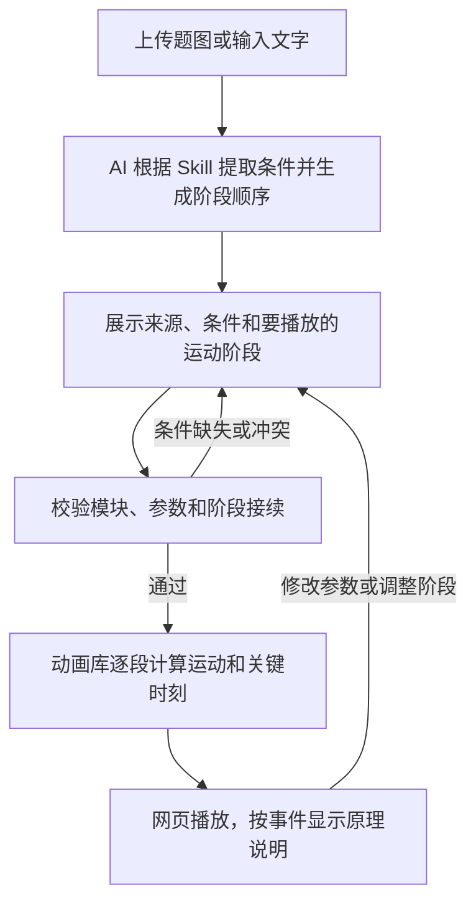

# 物理题动画生成器 · 参赛最终方案

2026 Qoder 高校创造力大赛 StudyHack 学习科研赛道。原排期以 **11 月 17 日开工、11 月 20 日完成基础公网主链验收、11 月 23 日提交** 为团队目标。动态组合和真题盲测纳入本次参赛提交，新增工作按第 6 节的里程碑推进。

## 1. 一周交付什么

学生上传一张高中力学题图片，或用文字描述题目及要看的过程。系统根据题意调用运动模块，组合并计算各段，生成可播放的动画。学生能核对题设、修改参数或调整要播放的阶段。画面、时间轴与关键事件的原理说明同步更新。

| 优先级 | 交付内容 |
|---|---|
| **P0 · 图文输入与动态组合** | 支持 JPG/PNG 单题图或文字描述。覆盖单物体多阶段运动，使用斜面滑动、水平滑动、弹簧压缩与反弹、抛体模块。根据实际题设确定运动阶段和接续条件。 |
| **P0 · 交互与公网交付** | Qoder Sites 公网访问。支持条件核对与编辑、按文字指令调整当前场景的阶段、播放、暂停、重播、下一关键点和内置示例。 |
| **P0 · 最终验收** | 5 道未预置、题设完整的高考物理运动真题全部首次自动生成正确。其中至少一道的完整阶段顺序未登记为整题预设。详见第 7 节。 |
| **后续迭代** | 运动库按第 8 节分批扩展。产品功能继续安排同类型题目推荐、保存题目、HEIC、滑块实时探索、时间轴吸附和分享链接。 |

后续版本可以按运动阶段和知识点推荐同类练习题。用户也可以保存题目，之后重新打开题设和对应动画复习。

斜面弹簧标准题和已写好的运动组合继续用作内置示例、联调样例及回归测试。真题验收走运动阶段的装配入口。每个运动模块接收起始位置、速度和题设参数，输出可取样的过程、结束事件与结束状态。上一段的结束状态按题设允许的连接规则传给下一段。

## 2. 工作流程



1. **AI 理解题意。** 用模块清单和适用前提处理题图或文字，输出结构化场景计划，包括题设参数、可确认的前提、运动阶段顺序和各段的结束条件。图片模糊或尺寸未标注时记录缺项。 [百炼视觉理解文档](https://help.aliyun.com/zh/model-studio/vision)
2. **程序装配。** 校验阶段是否可用、参数是否齐全、运动状态能否接续，再装配场景。斜面转水平方向时，根据题设给出的过渡前提确定是否保留速率。
3. **库逐段求解。** 计算每段时长、位置、速度和关键事件。若存在多个可能结束条件，由物理库计算哪个先发生。例如比较滑块停住和到达桌沿的时刻，只有到桌沿时仍有向外速度才接平抛。
4. **播放器呈现并重算。** 画面、字幕和事件使用同一条时间轴。保留原图或原文字供核对。修改参数或阶段后复用同一条装配与计算路径，几何、动画、字幕和时间轴一起更新。

## 3. 主演示题与物理原理

> 质量 1 kg 的滑块从一条长 4 m、倾角 37° 的粗糙斜面顶端由静止释放，释放后开始沿斜面下滑。斜面动摩擦因数为 0.5。斜面底端经过一段长度和高度变化均可忽略的光滑圆弧接到光滑水平面。轻弹簧处于原长时，左侧接触端在斜面底端右方 1 m，右端固定，劲度系数为 400 N/m。滑块与弹簧不连接。取 $g=10\ \mathrm{m/s^2}$，展示滑块从释放到压缩弹簧、反弹并脱离的全过程。

取斜面底端为坐标原点，水平向右、竖直向上。**数值和绘图统一用题面实际的 37°**，坡顶约为 $(-3.1945,\,2.4073)$ m。

- **沿斜面滑动。** 沿下坡方向加速度 $a=g(\sin\theta-\mu_k\cos\theta)$。起动由题设给出。动摩擦因数用于计算已经发生的滑动。 [OpenStax 摩擦](https://openstax.org/books/university-physics-volume-1/pages/6-2-friction)
- **转向与水平运动。** 在题设的光滑、近似无高度差过渡中，保留速率，把方向转为水平。播放器将这段极短过渡表示为一个瞬时事件。转向后水平匀速前进 1 m。 [OpenStax 机械能守恒](https://openstax.org/books/university-physics-volume-1/pages/8-3-conservation-of-energy)
- **接触弹簧。** 在光滑水平面上，弹簧接触后的角频率为 $\omega=\sqrt{k/m}$。以接触瞬间为计时起点，压缩量为 $x=\frac{v}{\omega}\sin(\omega t)$。四分之一周期达到最大压缩，半个周期恢复原长并脱离，脱离速度向左。 [OpenStax 简谐运动](https://openstax.org/books/university-physics-volume-1/pages/15-1-simple-harmonic-motion)

| 全程时刻 | 事件 | 验收数值 |
|---|---|---|
| 0 s | 释放 | 斜面加速度约 2.0250 m/s² |
| 1.9876 s | 到达坡底、转向水平 | 速率约 4.0249 m/s，位置连续 |
| 2.2361 s | 接触弹簧 | 滑块已水平前进 1.00 m |
| 2.3146 s | 压缩最短 | 压缩量约 0.2012 m，速度为 0，弹力约 80.50 N，向左 |
| 2.3932 s | 恢复原长并脱离 | 水平速度约 −4.0249 m/s |

对外演示时可以让评委把劲度系数改成 100 N/m。最大压缩量变为约 0.4025 m，接触弹簧的时刻仍约为 2.2361 s。

## 4. 开工前确认三份契约

### 4.1 AI 给后端的场景计划

模型输出结构化场景计划。后端检查数据结构，物理库检查适用前提和接续规则。数值统一成米、千克、秒及其导出单位，倾角用度。读不到的必填值用 `null`，前提事实用 `true`、`false` 或 `null`。缺项应能定位到相应阶段及字段，换算后的参数可与原图或原文字核对。

| 内容 | 约定 |
|---|---|
| 初始条件 | 物体的初始状态、题面参数，以及支撑面、弹簧或地面等绘制所需的条件。 |
| 阶段顺序 | 有序阶段列表。每段引用已登记的模块，列出适用前提和所需参数。 |
| 阶段接续 | 给出各段的终止条件及允许接续的阶段。物理库计算实际先发生的事件，并传递结束状态。 |

在实现前将正式字段、单位、状态及校验规则写入 [接口契约](CONTRACTS.md)，同步更新共享样例、播放器、Node 接口和 Qoder 云函数。Skill 说明可用模块、接续条件、参数单位和缺项规则，并给出开发样例。真题盲测使用单独选取的题目。

下面保留原斜面弹簧 `reading`，供内置示例及兼容性回归使用。

```json
{
  "templateId": "incline_spring",
  "conditions": {
    "gravityMps2": 10,
    "inclineAngleDeg": 37,
    "inclineLengthM": 4,
    "kineticFrictionCoefficient": 0.5,
    "initialSpeedMps": 0,
    "blockMassKg": 1,
    "springGapM": 1,
    "springConstantNpm": 400
  },
  "facts": {
    "slidesAfterRelease": true,
    "losslessTurn": true,
    "horizontalIsFrictionless": true,
    "springIsUnattached": true
  }
}
```

该回归场景沿用静止释放、坡底无损转向、水平面光滑和滑块与弹簧不连接等前提。动摩擦因数可以为零，质量、长度、间距、劲度系数和重力加速度应为有限正数，倾角须在 0° 与 90° 之间。静止释放且下坡加速度小于或等于零时，提示题设与下滑前提冲突。

### 4.2 图文输入与场景修改

`POST /api/animation/plan` 接收 `multipart/form-data`。题图用 `image` 字段，文字用 `text` 字段，两者至少提供一个。接口保留现有回包状态。

| 回包 | 页面行为 |
|---|---|
| 200，`ok` | 展示题设和阶段，调用场景装配与物理计算。 |
| 200，`needs_input` | 保留可确认的题设，提示补录具体阶段的缺项。题意识别不清时提示重拍或补充文字。 |
| 200，`unsupported` | 指出当前无法处理的运动或前提，提供内置示例入口。 |
| 400、502 或 504 | 提示图片无效、识别异常或超时。保留原输入并提供重试。 |

改参数和改阶段均走 `assembleScene → buildMotion`。例如在斜面弹簧示例里输入「只看斜面」，应保留原倾角、斜长和斜面摩擦等条件，重建截至滑块到达坡底的场景。装配失败时指出具体原因，保留原输入和最近一次有效动画。

### 4.3 动画库给播放器的产物

`assembleScene` 校验场景计划并装配场景，失败时返回可定位的字段或阶段错误。`buildMotion(scene)` 返回可播放结果，失败时返回可展示的 `code` 和 `message`。

| 字段或方法 | 约定 |
|---|---|
| `geometry` | 提供当前场景的米制绘制几何，例如斜面、水平面、弹簧和地面。题目未给弹簧原长时按示意绘制原长，压缩位移使用计算值。 |
| `durationSeconds`、`segments` | 总时长、实际经历的阶段和每段起止时间。 |
| `events` | 全程事件时间、名称和字幕。转向事件可带转向前后的速度向量。 |
| `sampleAt(timeSeconds)` | 返回同一坐标系下物体的位置、速度和对应绘制状态，例如弹簧压缩量。事件时刻采用事件后的状态。 |

播放器以计算结果中的事件决定下一关键点，绘图组件将物理坐标转换为屏幕坐标。舞台上的绘制要素和时间轴上的阶段都随场景计划重算。

## 5. 分工与 Qoder 协作

| 成员 | 开发责任 | 联调产物 |
|---|---|---|
| **A · 前端、播放器和集成** | 图文输入、原题与条件核对、阶段修改反馈，以及可复用的绘图组件、时间轴与字幕。负责浏览器联调。 | 给定一份合法场景计划即可播放，改参数或改阶段后正确更新。 |
| **B · 物理模块与场景装配** | 将斜面滑动、水平滑动、弹簧和抛体计算整理为可独立运行的模块，校验接续、传递状态、求解关键事件。维护数值验收基准。 | 用相同模块跑通标准题和从未登记的阶段组合，并通过边界与回归用例。 |
| **C · AI 接口、Skill 和部署** | 从图片或文字生成场景计划，回报缺项和超范围原因。同步 Node 与 Qoder 云函数入口，负责模型与公网部署。 | 公网真实模型能从图文题目返回实际可装配的计划，团队能直接进入盲测。 |

各成员对自己的联调产物负责，跨领域修复可以并行。共享字段、单位、状态或接口调整时，先更新契约和共享样例，再同步调用方。先用同一份场景计划联调，再接真实模型。密钥通过服务端环境变量保存。

## 6. 提交前里程碑

原团队提交目标为 **11 月 23 日**，新增工作按以下里程碑推进。

| 里程碑 | 通过条件 |
|---|---|
| 冻结首批模块和接续规则 | 写清模块的输入、结束事件和允许的接续条件。共享一份图文识别结果和一组物理对照值。 |
| 跑通首个新组合 | 选一条未登记为整题预设的阶段链，用现有模块计算并实际播放。已登记的斜面弹簧标准题通过回归。 |
| 公网图文联调 | 在 Qoder Sites 的公开地址使用真正的识别接口完成图文生成。验证改值、按文字调整阶段、缺项提示和失败后重试。 |
| 完成真题盲测和提交 | 冻结验收版本，提交五道题的首次结果及人工核对记录，完成演示、公开链接与天池作品帖。 |

若 Qoder Sites 账号仅支持静态部署，前端仍用 Qoder Sites 的公开地址，识别由团队可部署的服务端提供。发布后从公开链接验收实际图文链路。内置示例和录屏用于演示备用。原计划记录的赛事截止时间为 **11 月 30 日 18:00**，以赛事页面为准。 [Qoder Sites 文档](https://docs.qoder.com/zh/cli/sites) · [官方赛事说明](https://tianchi.aliyun.com/competition/entrance/532536)

## 7. 提交验收

### 7.1 必须通过的高考真题盲测

冻结验收版本、模块规则和识图提示词后，由队友选取 **5 道未用于开发或提示词编写、题设完整的真实高考运动题**。五题共同覆盖斜面、水平滑动、弹簧和抛体，均属于单物体多阶段运动，验收同时覆盖图片和文字入口。至少一道题的**完整运动阶段顺序**未登记为整题预设。

逐题在 Qoder Sites 的公开验收地址提交原始题图或完整题干，留存题目出处和首次生成结果。所有题目都应根据输入产出阶段计划，并实际调用计划中的运动模块。验收题及对应结果留在盲测记录中，开发样例与模型提示词使用独立题目。

**通过标准为 5/5 首次自动生成正确。** 逐题核对题设和单位、阶段顺序与事件分支、可由题设算出的关键时间/位置/速度，以及画面、时间轴和字幕。预期值由验收人独立求解或依据标准答案确定。补值、人工改阶段或重试后的结果单独记录。若基于已暴露的验收题调整实现或提示词，正式盲测使用另一组符合范围的未见题。

### 7.2 回归与交互验收

| 场景 | 通过条件 |
|---|---|
| 公网图文入口 | 用手机或无痕窗口打开公开地址，能使用图片和文字生成并播放动画。 |
| 斜面弹簧标准题 | 第 3 节的时间、速度、压缩量和弹力正确，转向位置连续，字幕与画面同步。 |
| 文字修改场景 | 在标准题中输入「只看斜面」，保留原斜面参数，画面只显示滑块与斜面，时间轴在到达坡底时结束。 |
| 运动分支 | 对初速 6 m/s、动摩擦因数 0.2、桌高 1.25 m、重力加速度 10 m/s² 的样例，距桌沿 5 m 时 1 s 离桌、再飞 0.5 s。改成 10 m 时，3 s 后停在距起点 9 m 处。 |
| 改值与补值 | 弹簧间距从 1 m 改为 2 m 后，接触时刻约变为 2.4845 s。可识别且缺项的题目补齐后能播放。 |
| 超范围及服务失败 | 对超范围运动给出具体提示。识别失败时保留原输入，提供重试与内置示例。 |

作品帖写明赛道、作品公网链接、使用的 Qoder 账号、做这个项目的原因、五步以内的体验方式、成员使用 Qoder 完成的工作和人工核对内容。确认全体成员按赛事要求完成认证。展示实测耗时和 5 道真题的盲测结果。 [官方提交要求](https://tianchi.aliyun.com/competition/entrance/532536/information)

## 8. 高中物理动画库扩展路线

扩展按下表顺序推进。力学阶段按接续规则组合，提供可取样的状态、几何和关键事件。第 7 节的参赛盲测范围和通过条件继续适用。本节的开发题用于回归与联调。

| 顺序 | 模块 | 典型场景与边界 |
|---|---|---|
| 基础 | 直线滑动与抛体 | 已有斜面、水平滑动、短过渡、弹簧接触反弹及抛体，用于回归。 |
| 第一批 | 圆周轨道与定轴摆、预压弹簧与能量、碰撞与动量、阶段接续 | 先打通弹簧滑块进圆轨道再飞出的题，再做摆锤在最低点碰撞，随后用同一套接续规则跑通斜面末端直接斜抛，详见 8.1。 |
| 第二批 | 多物体与约束 | 滑块与木板、传送带、轻绳与理想滑轮。重点处理相对速度、摩擦切换、共速及约束状态。 |
| 后续一 | 振动、波与引力 | 弹簧振子、单摆小角振动、机械波传播和叠加、万有引力与卫星轨道。 |
| 后续二 | 电与磁 | 静电场和带电粒子、电路、磁场弯轨以及电磁感应。 |
| 后续三 | 光、热与近代物理 | 反射与折射、透镜、干涉与衍射，气体状态变化、分子运动，以及光电效应等教学模型。 |
| 随相关模块接入 | 通用实验工具 | 频闪、打点计时器、光电门、位移与速度等图像，数据与动画共用时间轴。 |

### 8.1 第一批的制作和验收顺序

1. **圆轨道与预压弹簧释放。** 先实现光滑竖直内侧圆弧、法向力判定和切向接抛体。接着实现预压弹簧释放及粗糙水平段的接续，打通「弹簧释放 → 粗糙水平面 → 光滑竖直半圆内轨 → 抛体」。
   - 用题图中的 A、B、C 作画面和事件标记。原题给出 $m=0.1\ \mathrm{kg}$、$R=0.4\ \mathrm m$、$\mu_k=0.2$、$AB=2.0\ \mathrm m$、$g=10\ \mathrm{m/s^2}$，以及「恰好能通过最高点 C」。验收 C 点速率为 2 m/s，B 点压力为 6 N，初始弹性势能为 1.4 J。动画显示滑块从 C 点向左平抛。
   - 改变 $AB$ 时保持原题求出的弹性势能 1.4 J 和其余参数固定。在仍能于 B 前完成弹簧释放的前提下，验收 $AB=2$ m 到达 C 后飞出，$AB=3$ m 在 C 前失去接触并沿切线飞出，$AB=6$ m 在圆弧下半段停下后沿轨道返回。分别检查事件、位置、速度和字幕。
   - 原题未给劲度系数和初始压缩量，弹簧释放过程和 A 到 B 的总用时无法唯一确定。保留 A、B、C 与轨道示意，精确动画以 B 为计时起点并明确提示，说明如何由 C 点临界条件反推 B 点速度。若题设提供完整初值和弹簧条件，再连贯播放释放过程。两种情况均按题设求解，并记录参数是题面给定还是由明确条件推得。
2. **定轴摆与一维碰撞。** 用固定支点轻绳摆从给定角度释放，在最低点沿水平方向与目标物发生正碰。实现弹性碰撞与完全非弹性碰撞。分离后按题设分别计算摆锤继续摆动和目标沿指定轨道运动，粘连后按组合体继续摆动。验收用长 1 m 的摆从偏离竖直方向 60° 处静止释放、重力加速度 10 m/s²、两物体等质量且目标静止的样例。碰前摆锤速率为 $\sqrt{10}$ m/s，弹性正碰时交换水平速度，粘连时共同水平速度为 $\sqrt{10}/2$ m/s，之后按题设的连接约束继续运动。检查碰撞时的位置连续、碰前和碰后速度、摆锤与目标的时间轴同步。
3. **斜面末端直接斜抛。** 用屋顶积雪沿坡滑落后落地的题验收。抛出速度沿坡面切向，保留水平与竖直分量，落点由实际高度计算。验收离檐时刻的位置和速度连续，画面、时间轴和字幕都只展示实际经历的阶段。

### 8.2 开发与交接

- **B** 先在正式契约和共享样例写清每个新增模块的参数、前提、结束事件、状态接续、几何及缺项规则，再实现装配、校验和计算。沿用现有 `validateStagePlan → assembleScene → buildMotion` 入口与 `sampleAt`。已有单物体场景保持兼容。加入碰撞时，明确物体标识以及每个物体的取样状态和碰撞前后速度。
- **A** 用共享样例先接入圆弧、弹簧释放和抛体画面，随后接摆绳和多个物体。关键事件与画面共用时间轴，保留现有播放器操作。播放从 B 点开始时，把计时起点和原因显示在画面旁。
- **C** 根据稳定的契约同步图文入口的 Skill、接口校验和发布。AI 提取题设、明确约束和用户要看的范围，物理库计算阶段接续、关键数值和实际分支。用分阶段的开发样例联调，冻结后再跑独立真题盲测。
- 每个可独立验收的增量都用真实接入入口验证，检查适用条件、至少一个边界分支以及原有场景回归。开发人员分批提交到 GitHub，记录测试结果及可供 A、C 使用的样例。
