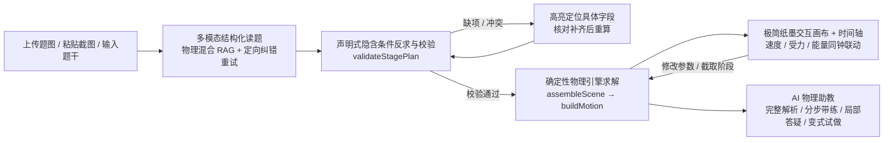

# VisualLab · 物理题动画生成器

VisualLab 是一款面向高中物理（力学与电磁场）的**交互式物理题动画生成与学习工具**。

输入一道物理题的题图或文字，系统会自动拆解运动阶段、校验题设前提，并由**确定性物理引擎**逐段计算轨迹、速度、受力与能量变化，生成可播放、可核对、可改值对比实验、可随时分步追问的交互式物理动画。

> **核心理念**：不做黑盒视频生成——**AI 只负责结构化读题与教学讲解，所有物理量全部由确定性数学与力学方程求解**。每一帧的位移、速度、支持力、张力、洛伦兹力与临界值都可以拿去对答案，修改任意参数即可在浏览器本地毫秒级重算。

---

## 工作原理



1. **AI 结构化读题 + 零依赖物理混合 RAG**：
   - 模型不直接“心算解题”，而是按结构化规则将题目拆解为有序阶段、国际单位制参数与前提条件；题面未给的参数诚实标为 `null`，不靠大模型臆测数值。
   - 内置三通道混合 RAG（阶段图 LCS/Jaccard + 物理词典 BM25 + MMR 多样性）与 32 道高考母题知识库，为读题、讲题与出变式题提供结构与易错点参照；若首次识别存在字段冲突，服务端自动附带 JSON Pointer 报错指引进行定向自修正。
2. **声明式反求与严格物理校验**：
   - `validateStagePlan` 负责单位、数值范围、阶段接续合法性与前提一致性检查。
   - 对高考高频隐含条件（如平抛切向入弧反求落差、由高度差与圆心角反求圆弧半径、临界过顶反求圆轨半径、预压弹簧临界能量反求等）直接由物理库解析反求，并标注推导来源。
3. **确定性多阶段物理引擎（`assembleScene → buildMotion`）**：
   - 纯 TypeScript 全程在米制物理单位下解析或高精度数值积分求解，自动判定真实先发生的物理分支（先停下还是先飞出桌沿、恰好过顶还是提前脱轨、先共速还是先滑离木板、重物着地后轻绳松弛、碰后多体并行轨道、电磁场切换与双粒子再相遇等）。
4. **同钟交互画布与本地毫秒重算**：
   - 画布、关键事件时间轴、实时受力矢量、能量读数与阶段说明共用同一物理时钟。修改条件、调整参数或截取阶段（如“只看前两段”）全部在浏览器本地即时重算，无需再次调用模型。

---

## 核心特点

- **数值可信，拒绝“物理幻觉”**：所有轨迹、时刻、速度、支持力 $N$、轻绳张力 $T$、洛伦兹力 $F_{\text{洛}} = q\vec{v}\times\vec{B}$（自适应宏牛、毫牛与科学计数法）以及动能/势能/累计摩擦耗能均由引擎实算生成，绝不伪造未知前段的用时或能量。
- **动态多过程组合，覆盖高考压轴综合题**：支持多阶段自由串联与同题多圆弧/多水平段并存，一镜到底还原 4～5 阶段综合大题；改大动摩擦因数、调小劲度系数或微调初速，即可实时观察“差一点过顶/脱轨”等临界分支变化。
- **教学级 AI 物理助教**：
  - **三种讲题模式**：点击「解析题目」可按需选择 **完整解析**（直接给受力分析、方程与数值）、**分步带练**（苏格拉底式逐阶段引导提问、不提前剧透答案）或 **局部答疑**（围绕当前关键事件自由追问）。
  - **一键相似变式题试做**：基于当前考点推荐同结构变式题，点击「生成动画试做」（支持加载态与悬停中断取消）即可直接生成新动画演练；同时支持在对话框直接粘贴题图或用自然语言修改当前动画条件。
- **克制清晰的视觉与学习工具**：
  - 统一等比取景与四角智能避让数据 HUD（默认右上角、自动避开动画与轨迹），无实色底块遮挡的描边速度标签（默认经典黑色，开启受力或进入磁场区时智能切换墨绿区分）。
  - 内置实时**受力矢量与正交分解**、**自由标注与自动渐隐临时标注**、**本地框选区域截图复制到剪贴板**、**自动调速/倍率胶囊/慢放本段/关键点自动暂停**、**预测练习**以及支持本地自动分类、筛选、编辑与快照恢复的**收藏/错题本**。
- **支持离线体验与双端同源部署**：Node 本地服务与云函数共享同一套校验、RAG 与读题规则源码，API Key 仅存于服务端环境变量；内置多道典型力学与电磁场精选例题，无网络或未配置 Key 时也能在浏览器完整运行仿真。

---

孤立双星圆轨道已接入：两星按质量比绕共同质心同步运行，支持由间距、周期和质量比反求质量；字段与边界见 [双星契约](BINARY_CIRCULAR_ORBIT.md)。

## 已覆盖的物理模型

| 类别 | 已支持模型与能力 |
|---|---|
| **单物体多过程** | 粗糙/光滑斜面上滑与下滑往返、坡底无损转向、水平定距/减速停止、水平与倾斜传送带（匀速/分段变速、双参考系与重滑判定）、平抛与斜抛（含落地首次弹性/非弹性弹跳）、固定竖直圆弧内轨与轻杆/双轨（支持力/拉力、过顶/脱轨/回滑）、光滑与粗糙弹簧接触回弹、预压弹簧静止释放、分段水平恒力、可自由滑动的圆弧/半圆弧槽、自由弹簧双球 |
| **多物体与复杂约束** | 轻绳单摆与等高钉子摆（张力/松绳判定）、水平/最低点/传送带末端弹性与完全非弹性正碰、碰后多体同步并行轨道（滑行/摆动/平抛）、滑块与可移动木板（共速/滑离/静摩擦阈值）、理想定滑轮连接体（悬挂/水平面/斜面、着地松绳） |
| **电磁场运动** | 垂直纸面匀强磁场中的单粒子偏转（区内忽略重力，离场后接续抛体）、双带电粒子匀强磁场再相遇碰撞、可切换电磁场区域碰撞 |
| **隐含条件反求** | 平抛切向入弧反求落差、圆弧高度差与圆心角反求半径、任意圆轨临界过顶反求半径、预压弹簧临界能量反求 |
| **同钟物理读数** | 瞬时速度矢量与分量、实时受力与正交分解、圆轨法向力 $N$、轻绳张力 $T$、洛伦兹力 $F_{\text{洛}}$、动能/弹性势能/重力势能与累计摩擦耗能、传送带对地与相对带面位移 |

---

## 快速开始

```bash
npm ci
```

1. **体验内置示例与前端交互（无需 API Key）**
   ```bash
   npm run build && npm run preview
   # 访问 http://127.0.0.1:4173/
   ```
2. **前端开发模式（热更新，`/api` 代理至 `8787`）**
   ```bash
   npm run dev
   # 访问 http://localhost:5173/
   ```
3. **完整前后端服务（启用 AI 读题、物理助教与相似题生成）**
   复制 `.env.example` 为 `.env`，填入 `DASHSCOPE_API_KEY`（兼容阿里云百炼多模态模型及 DeepSeek 等 OpenAI 兼容接口）：
   ```bash
   npm start
   # 访问 http://127.0.0.1:8787/（健康检查 GET /healthz）
   ```

---

## 本地验证命令

```bash
npm run typecheck          # TypeScript 类型检查
npm test                   # Vitest 全量单测（77 个测试文件 / 1051 条用例）
npm run test:physics       # 核心物理引擎基准测试（14 条）
npm run sync:functions     # 同步校验、RAG 与读题规则至云函数目录
npm run build              # 生产构建（输出至 dist/）
```

---

## 技术栈

- **前端与画布**：React 18 + TypeScript + Vite + 原生 HTML5 Canvas 2D
- **物理与检索引擎**：纯 TypeScript 确定性物理求解库（`src/physics/`）+ 零依赖物理混合 RAG（`src/rag/`）
- **服务端与部署**：Node HTTP 服务（`src/api/`）与云函数同源部署（`functions/`）
- **测试体系**：Vitest + Node 原生测试运行器
