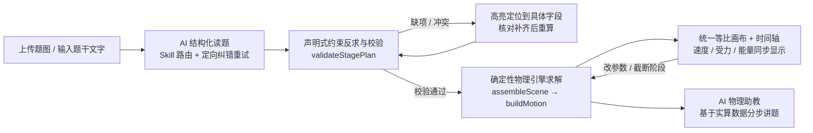

# VisualLab · 物理题动画生成器

VisualLab 是一款面向高中力学的**交互式物理题动画生成与学习工具**（2026 Qoder 高校创造力大赛 · StudyHack 学习科研赛道作品）。

学生上传一道高中力学题的图片或输入题干文字，系统会自动拆解物理过程、校验题设前提，并用**确定性物理引擎**逐段计算运动轨迹、速度、受力与能量变化，生成可播放、可核对、可改值重算、可随时提问的交互动画。

> **核心理念**：不做黑盒视频生成——**AI 只负责结构化读题，物理量全部由确定性数学与力学模型求解**。每一个时刻、速度、支持力和临界半径都可以复算对答案，每一个条件都可以随时修改并实时重算。

---

## 工作方式



1. **AI 结构化读题（不心算解题）**：视觉/语言模型按结构化 Skill 将题目拆分为有序阶段、国际单位制参数与前提事实；题面未给出的条件诚实标为 `null`，不靠大模型猜数。若首次输出存在字段冲突或类型错误，服务端会自动回传精确 JSON Pointer 报错进行至多 1 次定向自修正。
2. **声明式反求与严格校验**：`validateStagePlan` 负责范围、单位、接续规则与物理前提校验，并对高考高频隐含条件（如平抛切向入弧反求落差、由高度差与圆心角反求圆弧半径、临界过顶反求圆轨半径）进行精确求解，同时保留推导来源记录。
3. **确定性多阶段物理求解**：纯 TypeScript 物理库 `assembleScene → buildMotion` 全程在米制物理单位下解析或高精度积分求解，自动判定真实先发生的物理事件分支（例如先停下还是先到桌沿飞出、恰好过顶还是提前脱轨、先共速还是先滑出木板、重物着地后轻绳松弛等）。
4. **同钟交互播放与本地重算**：Canvas 画布、关键事件时间轴、阶段原理卡、能量/受力读数共用同一物理时钟。在「查看原题」抽屉中修改任意参数，或通过指令截取阶段（如「只看前两段」），均在浏览器本地毫秒级重算，无需再次调用模型。
5. **基于实算数据的 AI 物理助教**：右侧对话面板将当前题干、阶段参数、物理引擎实算出的关键事件数值及当前播放帧一并传给 AI，按高中物理教学逻辑分步讲解受力分析、守恒关系与临界条件。

---

## 核心优点与设计亮点

- **数值可信、敢拿去对答案**：摒弃容易产生“物理幻觉”的视频生成路线，所有轨迹、时间、速度、支持力 $N$、轻绳张力 $T$ 与机械能/摩擦耗能均由确定性方程算出，事件时刻精确停靠，绝不编造未知前段的用时或能量。
- **动态多过程串联，覆盖高考压轴综合题**：不是写死的单一整题模板，支持斜面、圆弧/整圆、水平面、平抛/斜抛、光滑与粗糙弹簧、预压释放、常力分段等模块自由组合，支持同题多圆弧/多水平段并存与自动衔接，可一镜到底呈现 4~5 阶段综合大题。
- **声明式反求，化解高考“隐含条件”痛点**：面对题干未直接给尺寸、而是通过“恰好沿切线滑入”“恰好通过最高点”等表述给出的高考真题，AI 只负责翻译题意声明约束，由物理库自动推导并标明推导来源。
- **透明可核对、改值即看对比实验**：右上角「查看原题」支持查看原题图片（支持点击全屏放大）及全部识别参数与前提；改大动摩擦因数、调小劲度系数或改变初速，画面、时间轴与真实结局分支同步切换，适合探究“差一点脱轨”等临界现象。
- **统一取景与观看节奏体验**：单物体与多物体画布共享统一等比投影与像素留白，横长场景占足横向宽度、多标签自动防重叠；桌面单/多物体画布等高无挤压，移动端自动切换播放/对话双标签。播放器支持自动调速（仅对过快/过短动画放慢，绝不强行加速，并提供开关）、手动倍率、`慢放本段` 与 `关键点自动暂停`。
- **双端同源、安全且支持离线体验**：Node 本地服务与 Qoder Sites 云函数共享同一套校验与 Skill 源码（`sync-functions.mjs` 自动同步），模型 API Key 仅保存在服务端环境变量；内置 4 道多模型压轴示例，无网络或未配置 Key 时仍可在浏览器完整运行物理仿真。

---

## 已覆盖的物理模型

| 类别 | 已实现模块与能力 |
|---|---|
| **单物体多过程组合** | 粗糙/光滑斜面滑动、无损转向、水平定距/减速停止、平抛与斜抛（相对落差/固定地面）、斜面末端直接斜抛、光滑竖直圆轨与任意入口圆弧（支持力、过顶/脱轨/回滑判定）、光滑/粗糙弹簧接触（静摩擦上限判定与残余压缩）、预压弹簧释放、常力与分段匀变速 |
| **多物体与复杂约束** | 轻绳摆与张力/松绳判定、水平/最低点弹性与完全非弹性正碰、碰后多体同步并行轨道（滑动/摆动/平抛）、滑块与可移动木板（共速/到边/共速后静摩擦阈值）、匀速与分段加速传送带（双参考系与重滑判定）、轻绳与理想定滑轮连接体（两端悬挂/水平面/斜面、着地松绳） |
| **匀强磁场偏转及出射** | 垂直纸面的匀强磁场中单粒子偏转（区内忽略重力），按实际离场状态接续仅受重力的抛体 |
| **隐含条件反求** | 平抛切向入弧反求落差、圆弧高度差与圆心角反求半径、任意圆轨临界过顶反求半径、预压弹簧临界能量反求 |
| **同钟物理读数** | 瞬时速度矢量与分量、圆轨法向支持力 $N$、轻绳张力 $T$、动能 / 弹性势能 / 重力势能与累计已知摩擦耗能、传送带对地/相对带面位移 |

---

## 内置精选示例

应用内置 **4 道多阶段、多模型串联的高考级综合题**（均附原题图片，点右上角「查看原题」可直接看图并点击放大）：

1. **平抛入弧 · 粗糙水平 · 临界整圆**：4 阶段（平抛切向入弧 BC → 粗糙水平 CD → 临界整圆 DE，自动反求 3 项隐含几何）
2. **碰后飞出桌面 · 平抛**：双体弹性正碰 → 碰后一物飞出桌沿平抛、另一物反弹同步滑行
3. **斜面 · 圆弧过渡 · 粗糙水平 · 弹簧回弹**：4 阶段 4 模型（粗糙斜面 → 光滑圆弧 → 粗糙水平 → 粗糙弹簧压缩回弹 + 同钟能量显示）
4. **弹簧弹射 · 圆弧跳台 · 斜抛 · 切向入斜坡**：5 阶段 5 模型（预压弹簧释放 → 粗糙水平 → 45° 圆弧跳台 → 斜抛过最高点 → 53° 粗糙斜坡 + 同钟能量显示）

---

## 快速开始

```bash
npm ci
```

按使用场景选择启动方式：

1. **体验内置示例与前端交互（无需 API Key）**
   ```bash
   npm run build && npm run preview
   # 访问 http://127.0.0.1:4173/
   ```
2. **前端开发模式（热更新，`/api` 默认代理至 `8787`）**
   ```bash
   npm run dev
   # 访问 http://localhost:5173/
   ```
3. **完整同域前后端服务（启用真实 AI 读题与物理助教对话）**
   复制 `.env.example` 为 `.env`，填入 `DASHSCOPE_API_KEY`（支持阿里云百炼 `qwen4-max` 图文识别，也支持 DeepSeek 等 OpenAI 兼容纯文字接口）：
   ```bash
   npm start
   # 访问 http://127.0.0.1:8787/（健康检查 GET /healthz）
   ```

---

## 本地验证与测试

```bash
npm run typecheck          # TypeScript 类型检查（0 错误）
npm test                   # Vitest 全量单测（55 个测试文件 / 747 条用例）
npm run test:physics       # 核心物理库基准测试（14 条）
npm run sync:functions     # 同步阶段校验与 Skill 至 Qoder 云函数目录
npm run build              # 生产构建（输出至 dist/）
```

浏览器真机回归需先启动预览服务与带远程调试端口的 Edge/Chromium（`npm run preview` → `4173`，`--remote-debugging-port=9222`），再运行 `npm run test:ui`（逐条说明见 [ACCEPTANCE.md](ACCEPTANCE.md)）。

---

## 架构文档与团队分工

| 文档 | 内容 |
|---|---|
| [PROJECT_PLAN_FINAL.md](PROJECT_PLAN_FINAL.md) | 产品范围、路线图（§8 首批/第二批/后续规划）与验收标准 |
| [STAGE_COMPOSITION.md](STAGE_COMPOSITION.md) | 动态阶段组合契约、校验状态码与接续口径 |
| [GAOKAO_MULTI_STAGE.md](GAOKAO_MULTI_STAGE.md) | 高考多过程串联、圆弧自动衔接与声明式反求契约 |
| [CONTRACTS.md](CONTRACTS.md) | 首版图文接口、识别 JSON 与播放器接口契约 |
| [AGENTS.md](AGENTS.md) | 三人协作边界与工程约定 |

**三人协作分工**：
- **A · 前端与联调（`src/ui/`）**：图文输入、原题与条件编辑抽屉、Canvas 统一取景绘制、播放器控制与移动端适配。
- **B · 动画与物理库（`src/physics/`）**：参数校验、声明式反求、场景装配、多阶段/多物体运动求解与数值验收基准。
- **C · AI 接口与部署（`src/api/`、`skills/`、`functions/`）**：读题 Skill、定向纠错重试、AI 助教通路、Node 与 Qoder Sites 云函数同步部署。
